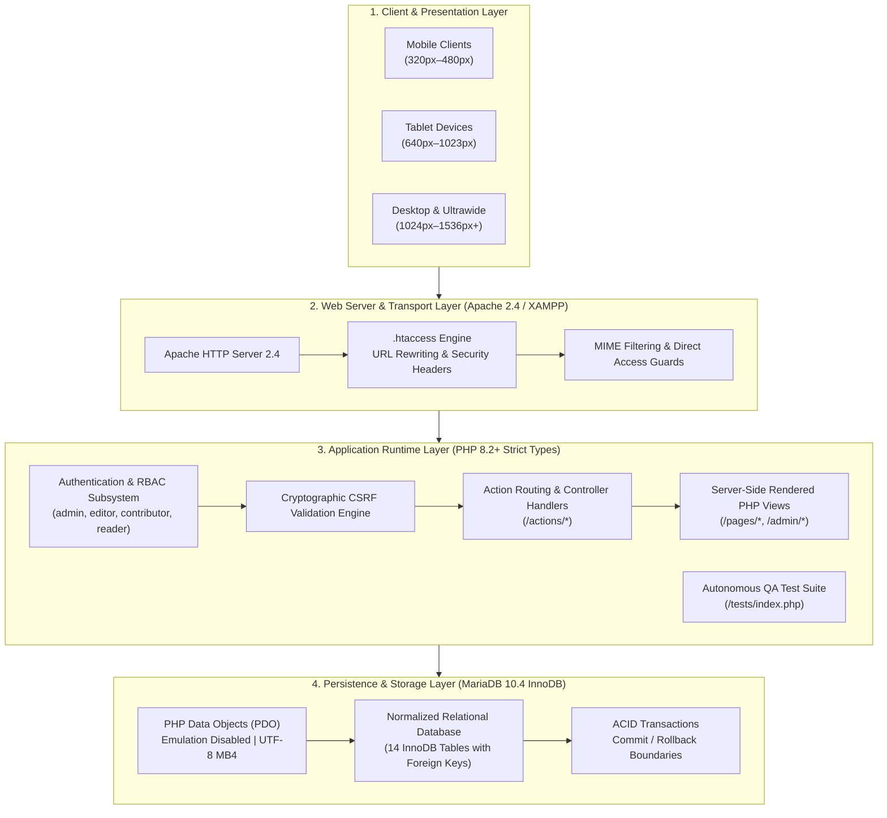

# LagunaWISE Ideology Division — Full Technical Stack Specification

```
   __                                    _       _____ _____ ______ 
  / /   ____ _____ ___  ______  ____ _  | |     / /  _/ ___// ____/ 
 / /   / __ `/ __ `/ / / / __ \/ __ `/  | | /| / // / \__ \/ __/    
/ /___/ /_/ / /_/ / /_/ / / / / /_/ /   | |/ |/ // / ___/ / /___    
\____/\__,_/\__, /\__,_/_/ /_/\__,_/    |__/|__/___//____/_____/    
           /____/                                                   
                IDEOLOGY DIVISION EDITORIAL PLATFORM
```

---

## 1. Executive Summary & Architectural Philosophy

The **LagunaWISE Ideology Division** platform is a high-performance, nonpartisan editorial publication, research archive, and civic inquiry system. Developed for the education and civic advancement of Laguna and the digital sphere, the platform is engineered around three non-negotiable principles:

1. **Zero Fake Content Policy**: The platform operates strictly on real MariaDB data with zero hardcoded dummy records, fake users, synthetic engagement stats, or simulated metrics.
2. **Defensive Security & Strict RBAC**: Every route, model, action, and API interaction is protected by cryptographic CSRF tokens, strict session hygiene, SQL injection immunity through PDO prepared statements, XSS output encoding, and multi-tier Role-Based Access Control.
3. **Responsive Editorial Elegance**: A mobile-first, multi-column grid architecture compliant with WCAG 2.2 accessibility standards, fluid typography, dark navy visual identity (`#061638`), and crisp editorial geometry.

---

## 2. High-Level Architecture Diagram



---

## 3. Technology Stack Breakdown

### 3.1 Backend Runtime & Language
* **Language & Version**: **PHP 8.2+** (compatible with PHP 8.4+)
* **Type Safety**: Enforced strict typing across all executable files (`declare(strict_types=1);`).
* **Architecture Pattern**: Clean Modular Procedural / Layered MVC with dedicated configuration (`/config`), procedural security and database wrappers (`/includes`), controller-like action endpoints (`/actions`), and administrative dashboards (`/admin`).
* **Session Management**: Native PHP sessions configured with `cookie_httponly = 1`, `cookie_secure` auto-detection, `use_strict_mode = 1`, `cookie_samesite = 'Lax'`, and automatic session regeneration upon authentication state transitions.

### 3.2 Database & Storage Engine
* **RDBMS Engine**: **MariaDB 10.4.32+ / MySQL 8.0+**
* **Storage Engine**: `InnoDB` with full foreign key referential integrity (`ON DELETE CASCADE` / `ON DELETE RESTRICT`).
* **Character Set & Collation**: `utf8mb4` with `utf8mb4_unicode_ci` ensuring multilingual emoji and unicode support.
* **Database Driver**: **PHP Data Objects (PDO)** with persistent attributes:
  ```php
  PDO::ATTR_ERRMODE            => PDO::ERRMODE_EXCEPTION,
  PDO::ATTR_DEFAULT_FETCH_MODE => PDO::FETCH_ASSOC,
  PDO::ATTR_EMULATE_PREPARES   => false, // Guarantees native server-side prepared statements
  ```
* **Database Schema Entities (14 Tables)**:
  1. `roles` — System access tiers (administrator, editor, contributor, reader).
  2. `users` — Authenticated accounts with hashed credentials and profile metadata.
  3. `user_roles` — Junction table supporting multi-role assignments.
  4. `categories` — Predefined editorial inquiry taxonomy desks.
  5. `articles` — Peer-reviewed monographs, investigative briefings, and toolkits.
  6. `article_revisions` — Full audit history of editorial changes.
  7. `article_sources` — Academic citations, fieldbook references, and source URLs.
  8. `announcements` — Official division bulletins and symposia notices.
  9. `comments` — Moderated community dialogues.
  10. `bookmarks` — Saved reading lists per authenticated reader.
  11. `newsletter_subscribers` — Double-opted email subscribers for Fortnightly Dispatch.
  12. `activity_logs` — Tamper-evident administrative audit trail.
  13. `website_settings` — Key-value operational configurations.
  14. `tags` — Cross-cutting thematic indexing taxonomy.

### 3.3 Server & Hosting Environment
* **Web Server**: **Apache 2.4** (XAMPP Environment)
* **Configuration Layer (`.htaccess`)**:
  * Blocks direct access to sensitive file formats (`.sql`, `.log`, `.sh`, `.env`, `.git`).
  * Enforces directory indexing prevention (`Options -Indexes`).
  * Emits security headers:
    * `X-Content-Type-Options: nosniff`
    * `X-Frame-Options: SAMEORIGIN`
    * `X-XSS-Protection: 1; mode=block`
    * `Referrer-Policy: strict-origin-when-cross-origin`
  * Uploads directory protection preventing script execution inside media folders.

### 3.4 Frontend Styling & Design System
* **CSS Framework**: **Tailwind CSS 3.4** (Optimized Utility Pipeline)
* **Design Identity & Palette**:
  * **Deep Navy**: `#030D22` (Darkest header/section background)
  * **Primary Navy**: `#061638` (LagunaWISE Hero & Branding Navy)
  * **Secondary Navy**: `#0B2252` (Sidebar & card accents)
  * **LagunaWISE Blue**: `#1557A6` (Primary interactive color & buttons)
  * **Technology Blue**: `#2799E8` (Active indicators & focus rings)
  * **Ice Light Blue**: `#DCEEFF` (Badges & highlight pills)
  * **Silver Accent**: `#C5CEDB` (Secondary text on dark surfaces)
  * **Light Canvas Surface**: `#F4F7FB` (Background for readability)
* **Typography**:
  * Headings: **Plus Jakarta Sans** (`wght@600;700;800`)
  * Body Text: **Inter** (`wght@400;500;600`)
  * Editorial Longform: **Source Serif 4** (`wght@400;600;700`)
* **Geometry**: Crisp editorial corners (`rounded-lg`, `rounded-md`, `rounded-sm`) replacing excessive bubble radiuses.
* **Visual Effects**: Custom keyframe animations (`shimmer`, `fadeIn`), skeleton loaders (`.skeleton`, `.skeleton-dark`), and active page progress indicators (`#top-loading-bar`).

### 3.5 Client-Side Logic & Scripting
* **Scripting Language**: **Vanilla JavaScript (ES6+)**
* **Zero External JS Frameworks**: No heavy Node/React/Vue bundle dependencies. Pure browser-native execution with near-instant Time to Interactive (TTI).
* **Interactive Capabilities**:
  * Responsive mobile drawer navigation with ARIA state toggling.
  * Search dialog with escape key detection and autofocus.
  * Interactive user dropdown menus with outside-click dismissal.
  * Smooth in-page section scrolling.
  * Real-time client-side password strength and validation feedback.

### 3.6 Assets & Visual Media
* **Official Vector Emblem**: High-resolution Laguna map mark (`assets/images/lagunawise-map-logo.png`).
* **Official Wordmark**: Cropped white typography wordmark (`assets/images/lagunawise-wordmark-text.png`).
* **Vector Graphics**: Handcrafted SVG illustrations for all 8 editorial category desks and default avatars.
* **Icon Library**: **Font Awesome 6 Free CDN** (`fa-solid`, `fa-brands`, `fa-regular`).

---

## 4. Security & Hardening Architecture

```
[ Incoming Request ]
         │
         ▼
[ .htaccess Filter ] ─────── (Blocks .sql, .log, .env, hidden files)
         │
         ▼
[ Session Verification ] ─── (Checks session lifetime & HTTP headers)
         │
         ▼
[ CSRF Guard ] ──────────── (Validates cryptographic anti-CSRF token on all POSTs)
         │
         ▼
[ RBAC Authorization ] ──── (Verifies caller holds required system role)
         │
         ▼
[ Input Sanitization ] ──── (Type casting, regex, length constraints)
         │
         ▼
[ PDO Prepared Query ] ──── (Parameter bindings; emulation disabled)
         │
         ▼
[ XSS-Safe Render ] ─────── (All output escaped via htmlspecialchars ENT_QUOTES)
```

1. **Cross-Site Request Forgery (CSRF)**:
   * Tokens generated via `random_bytes(32)`.
   * Form helper `csrf_field()` and header validator `csrf_token()`.
   * Enforced across all state-changing endpoints (`/actions/*`, `/auth/*`, `/admin/*`).
2. **Cross-Site Scripting (XSS)**:
   * Global output escaping wrapper `e($string)` utilizing `htmlspecialchars($string, ENT_QUOTES | ENT_SUBSTITUTE, 'UTF-8')`.
3. **SQL Injection (SQLi)**:
   * 100% prepared statements with native parameter binding. Zero dynamic string concatenation in SQL queries.
4. **Credential Security**:
   * Password hashing utilizing PHP `password_hash()` with `PASSWORD_DEFAULT` (Argon2id or Bcrypt).
   * Constant-time verification using `password_verify()`.

---

## 5. Antigravity Agent Skills & Engineering Tooling

The project incorporates specialized Antigravity workspace skills located in `.agents/skills/`:

| Skill Name | Location | Capability & Focus |
| :--- | :--- | :--- |
| **`php-development`** | `.agents/skills/php-development/` | PHP 8.2+ idioms, PDO transactions, RESTful APIs, XAMPP environment configurations, and authentication workflows. |
| **`frontend-design`** | `.agents/skills/frontend-design/` | Anthropic frontend design framework for intentional editorial aesthetics, visual hierarchy, and distinct brand identities. |
| **`architecture`** | `.agents/skills/architecture/` | ADR documentation, trade-off analysis, modular domain design, and software architecture patterns. |
| **`frontend-skill`** | `.agents/skills/frontend-skill/` | Modern CSS grid, responsive layout engineering, and accessibility best practices. |
| **`web-application-security`** | `.agents/skills/web-application-security/` | OWASP Top 10 remediation, header configurations, session hardening, and secure submission pipelines. |
| **`accessibility`** | `.agents/skills/accessibility/` | WCAG 2.2 AA/AAA compliance, screen reader support, keyboard navigation, and color contrast auditing. |

---

## 6. Verification & Automated Quality Assurance

The codebase includes an integrated, autonomous test suite accessible via CLI and browser:
* **Test Suite File**: [`tests/index.php`](file:///c:/xampp/htdocs/LW-ideology/tests/index.php)
* **Execution**: `php tests/index.php` or `http://localhost/LW-ideology/tests/index.php`
* **Coverage**: **22 Automated Test Suites (100% Passing)**:
  * PDO Connection & MariaDB Driver Verification
  * 14 Database Schema Tables & Column Definitions
  * Extended Metadata Integrity (`references_sources`, `tags`)
  * Official Branding Assets Resolution & Dimensions
  * Zero Fake Content Policy Verification
  * CSRF Token Generation & Tamper Rejection
  * User Registration Validation & Duplicate Email Rejection
  * Password Cryptographic Hashing
  * Contributor Article Creation & Editorial Queue Routing
  * Editor Peer Review & Publication Pipeline
  * Ownership Access Boundaries & Foreign Article Tamper Prevention
  * Administrative Privilege Isolation

---

## 7. Cleaned Directory Layout

```
c:\xampp\htdocs\LW-ideology\
├── .agents/
│   └── skills/                 # Antigravity agent engineering skills
│       ├── accessibility/
│       ├── architecture/
│       ├── frontend-design/
│       ├── frontend-skill/
│       ├── php-development/
│       └── web-application-security/
├── actions/                    # State-changing POST controllers (CSRF-protected)
│   ├── article-action.php
│   ├── bookmark-action.php
│   ├── comment-action.php
│   └── newsletter-action.php
├── admin/                      # Editorial & administrative CMS portal
│   ├── includes/               # CMS header, sidebar, footer partials
│   ├── announcements.php
│   ├── article-create.php
│   ├── article-edit.php
│   ├── articles.php
│   ├── categories.php
│   ├── comments.php
│   ├── dashboard.php
│   ├── index.php
│   ├── media.php
│   ├── profile.php
│   ├── settings.php
│   ├── submissions.php
│   └── users.php
├── assets/                     # Static production assets
│   ├── images/                 # Optimized SVGs, brand logos, avatars
│   │   ├── article-*.svg       # 8 editorial desk category icons
│   │   ├── avatar-*.svg        # Vector role avatars
│   │   ├── default-avatar.svg
│   │   ├── lagunawise-map-logo.png
│   │   └── lagunawise-wordmark-text.png
│   └── uploads/                # User uploaded media (.htaccess guarded)
├── auth/                       # Authentication flow endpoints
│   ├── forgot-password.php
│   ├── login.php
│   ├── logout.php
│   └── register.php
├── cli/                        # Command-line administrative utilities
│   └── create-admin.php
├── config/                     # Core system configurations
│   ├── app.php
│   ├── database.php
│   └── security.php
├── database/                   # Schema migrations & initial seeds
│   ├── schema.sql
│   └── seed.sql
├── documentation/              # Architecture, database & user manuals
│   ├── screenshots/            # Automated verification proofs
│   ├── DATABASE.md
│   ├── INSTALLATION.md
│   ├── INSTALLED_SKILLS.md
│   └── USER_GUIDE.md
├── includes/                   # Global components & business logic
│   ├── auth.php
│   ├── footer.php
│   ├── functions.php
│   └── header.php              # Two-tier responsive editorial header
├── pages/                      # Public facing views
│   ├── about.php
│   ├── article.php
│   ├── article-preview.php
│   ├── articles.php
│   ├── contact.php
│   ├── dashboard.php
│   ├── news.php
│   ├── search.php
│   ├── sitemap.php
│   ├── topic.php
│   └── topics.php
├── tests/                      # Automated quality assurance suite
│   └── index.php
├── .gitattributes
├── .gitignore
├── .htaccess                   # Production Apache security rules
├── index.php                   # Homepage (CNN-style layout)
├── PROJECT_PLAN.md
├── README.md
├── robots.txt
└── TECH_STACK.md               # This document
```
